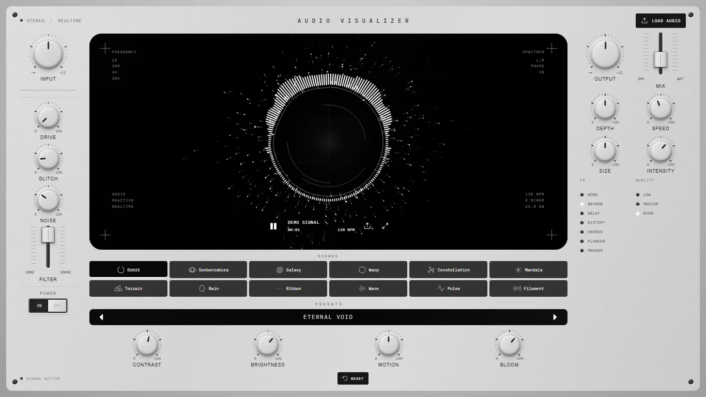
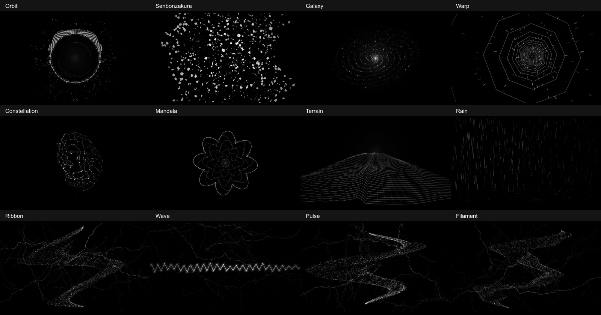
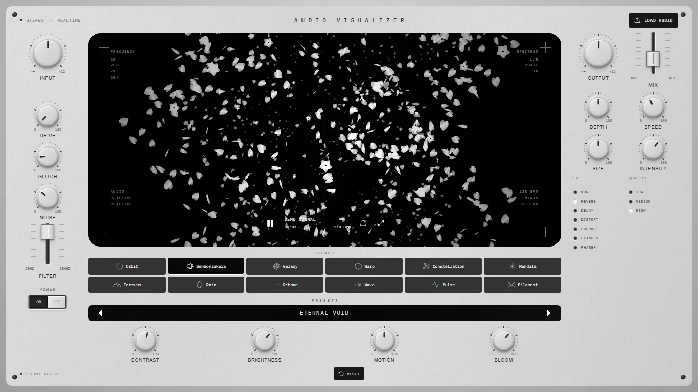
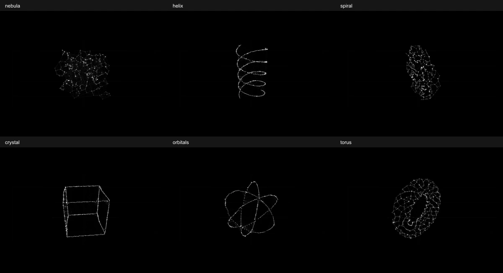
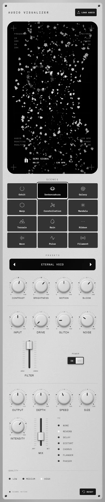
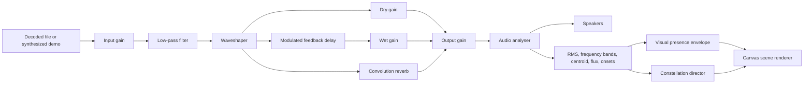

# Audio Visualizer

A monochrome, audio-reactive visual instrument built with **Next.js, React, TypeScript, Bun, Canvas 2D, and the Web Audio API**. Twelve procedural scenes turn your music into particle sculptures, circular spectra, cherry blossoms, evolving constellations, and more.



[Quick start](#quick-start) · [Scenes](#visual-scenes) · [Constellation](#constellation-choreography) · [Controls](#controls) · [Architecture](#architecture) · [Testing](#testing) · [Troubleshooting](#troubleshooting)

## Features

- **Actual audio response.** Visuals measure the same post-effects, post-volume signal sent to the speakers.
- **Twelve scenes.** Choose circular spectra, particles, blossoms, galaxies, tunnels, constellations, mandalas, terrain, rain, and waveform displays.
- **Evolving Constellation.** Eleven formations morph according to musical peaks, spectral balance, estimated rhythm, and track progress.
- **Local playback.** Load or drop an audio file, or start the built-in synthesized electronic demo. Selected files are decoded in the browser.
- **Gradual appearance and disappearance.** Visuals emerge with the music and dissolve into randomly scattered fragments when sound stops. Silence leaves no idle waveform or particle sculpture.
- **Occasional progressive lightning.** Some strikes draw toward their targets, with branches revealing as the parent line reaches them.
- **Tactile controls.** Matte hardware-style dials, faders, audio effects, presets, keyboard controls, seeking, and fullscreen.
- **Responsive layout.** Desktop controls fit the available window height. Phones use a vertical layout with touch controls below the display.
- **Adjustable quality and reduced motion.** Rendering density, frame rate, and motion adapt to the selected settings.
- **No account or API keys.** The app needs no database or external audio service.

## Quick start

### Requirements

| Requirement | Details                                                                                             |
| ----------- | --------------------------------------------------------------------------------------------------- |
| Bun         | The project pins **1.3.14** in `package.json`.                                                      |
| Node.js     | **20.9.0 or newer**, matching the installed Next.js package's engine requirement.                   |
| Browser     | A browser with Canvas 2D and Web Audio support. Codec and fullscreen support depend on the browser. |

### Install and run

```sh
git clone https://github.com/sossisuka/audio-visualizer.git
cd audio-visualizer
bun install --frozen-lockfile
bun run dev
```

Open **http://localhost:3000**.

If that port is occupied:

```sh
bun run dev --hostname 127.0.0.1 --port 43127
```

Open **http://127.0.0.1:43127**. This is also the address used by the browser verification scripts.

### Production

```sh
bun run build
bun run start
```

The production server defaults to port 3000. You can pass a different port with `bun run start --port 43127`.

No environment variables are required for the current application.

## Playing music

1. **Press Play** to hear the built-in electronic demo, synthesized at 138 BPM in E minor.
2. **Load audio** using either upload button, or drop a file onto the display. Successfully decoded files begin playing automatically.
3. **Choose a scene** below the display. Switching scenes keeps playback running.
4. **Shape the result** with the dials, faders, presets, and audio effects.
5. **Seek** with the white timeline when playing a loaded file. The generated demo has no fixed duration or seek bar.

The file picker accepts common audio extensions, including MP3, WAV, M4A, OGG, FLAC, AAC, and AIFF. Actual decoding support comes from the browser. WAV or MP3 are useful alternatives if a particular file cannot be opened.

## Visual scenes



| Scene             | Appearance and behavior                                                                                                                      |
| ----------------- | -------------------------------------------------------------------------------------------------------------------------------------------- |
| **Orbit**         | A mirrored circular frequency spectrum, an inner waveform ring, rotating arcs, and particles emitted on audio transients. The default scene. |
| **Senbonzakura**  | Up to a thousand fluttering, notched cherry petals, occasional complete five-petal blossoms, and dispersed petal bursts.                     |
| **Galaxy**        | A rotating five-arm star field, luminous core, spectral detail, and bass-driven expansion.                                                   |
| **Warp**          | A twisting perspective tunnel with streaming star trails.                                                                                    |
| **Constellation** | A connected star mesh that morphs between eleven procedural formations, with travelling pulses and synthesized motion.                       |
| **Mandala**       | Seven nested spectrum flowers with mirrored geometry. Presets change their symmetry.                                                         |
| **Terrain**       | A moving wireframe landscape whose peaks respond to frequency energy.                                                                        |
| **Rain**          | Falling light streaks and elliptical impact ripples shaped by the signal.                                                                    |
| **Ribbon**        | The original twisting particle sculpture with transient lightning. Internally named `Particle`.                                              |
| **Wave**          | Eleven layered traces of the actual time-domain waveform.                                                                                    |
| **Pulse**         | A particle ribbon with stronger bass-driven expansion. Internally named `Beat`.                                                              |
| **Filament**      | An intricate oscillating particle filament. Internally named `Visual`.                                                                       |

### Senbonzakura

Petals rotate, flutter, drift through depth layers, and join a swirling flow. Musical transients add dispersed bursts. The petals remain white and gray to match the instrument's monochrome lighting.



## Constellation choreography

Constellation keeps the same star identities while changing their target geometry. Each transition uses quintic easing and damped positions. Neighbor connections fade as the mesh rewires, keeping the transformation continuous.



### Formations

| Formation | Geometry                                     |
| --------- | -------------------------------------------- |
| Nebula    | A distributed three-dimensional star cloud.  |
| Sphere    | Points distributed over a spherical surface. |
| Torus     | A ring-shaped surface with visible depth.    |
| Helix     | Two intertwined helical strands.             |
| Spiral    | A multi-arm spiral arrangement.              |
| Rose      | A five-lobed radial flower.                  |
| Knot      | A three-dimensional torus knot.              |
| Crystal   | Stars arranged along a cube's edges.         |
| Orbitals  | Three intersecting orbital rings.            |
| Supernova | A radial, three-dimensional starburst.       |
| Lissajous | Intersecting harmonic curves.                |

### How music directs the shapes

The director combines several measurements:

- **Onsets and peak strength** influence when a transformation begins and how strongly the mesh expands.
- **Bass, mids, and treble** influence the weighted choice of the next formation.
- **Spectral entropy and centroid changes** influence the response to tonal detail, brightness, and complexity.
- **Short versus long energy levels** identify changes in intensity.
- **Observed onset intervals** provide an estimated pulse period and confidence.
- **Track position and duration** provide coarse progression cues for loaded files.

These are procedural heuristics. Track progression is divided into eight coarse regions; the app does not label actual verses, choruses, chords, or musical keys.

Formations have a minimum hold interval, an ongoing morph finishes before another starts, and the three most recent formations are excluded from the next choice. Sustained audio can still evolve through a slower cue without inventing drum events.

Within each shape, additive spectral partials, frequency modulation, actual waveform displacement, and propagating peak fronts animate the stars. The choreography continues following the track while another scene is selected. Pausing freezes both morph progress and synthesis phase. Seeking clears stale rhythm predictions while retaining star identity.

## Controls

### Dials

| Dial           | Controls                                                                    |
| -------------- | --------------------------------------------------------------------------- |
| **Input**      | Gain entering the audio processing chain.                                   |
| **Output**     | Final audio level; reducing it also reduces the signal driving the visuals. |
| **Drive**      | Waveshaper saturation and distortion.                                       |
| **Glitch**     | Occasional positional disruptions in supported visual geometry.             |
| **Noise**      | Particle spread and fine spectral turbulence.                               |
| **Depth**      | Perspective, depth, or tilt according to the selected scene.                |
| **Speed**      | Visual movement rate.                                                       |
| **Size**       | Overall visual scale.                                                       |
| **Intensity**  | Visual light intensity.                                                     |
| **Contrast**   | Visual luminance scaling.                                                   |
| **Brightness** | Overall visual brightness.                                                  |
| **Motion**     | Deformation, flow, and movement intensity.                                  |
| **Bloom**      | Glow strength.                                                              |

To operate a dial:

| Interaction             | Result                          |
| ----------------------- | ------------------------------- |
| Drag upward or downward | Increase or decrease the value. |
| Arrow keys              | Change by 1.                    |
| Shift + arrow keys      | Change by 5.                    |
| Page Up / Page Down     | Change by 10.                   |
| Home / End              | Set to 0 / 100.                 |
| Double-click            | Set the dial to 50.             |

### Faders and audio effects

- **Filter:** a logarithmically mapped low-pass cutoff, from 20 Hz to 20 kHz.
- **Mix:** the selected effect's dry/wet amount; also controls drive amount for Distort.
- **FX:** None, Reverb, Delay, Distort, Chorus, Flanger, or Phaser.

Reverb uses a generated convolution impulse. Delay uses a feedback delay. Chorus, Flanger, and the Phaser-labeled variation use modulated delay configurations; the Phaser variation is not an all-pass filter phaser.

### Presets and utility controls

The four presets—**Eternal void**, **Ghost in the signal**, **Static bloom**, and **Afterimage**—apply different combinations of Depth, Speed, Size, Noise, and Bloom. They preserve the selected scene and current playback.

| Control      | Behavior                                                                                 |
| ------------ | ---------------------------------------------------------------------------------------- |
| Power        | Turns the visualization on or off; switching off also pauses playback.                   |
| Play / Pause | Starts or pauses the demo or loaded file. Playing from standby powers the visualizer on. |
| Timeline     | Seeks within a decoded audio file.                                                       |
| Load audio   | Opens the local file picker.                                                             |
| Fullscreen   | Expands the visual display using browser fullscreen or an in-page fallback.              |
| Reset        | Restores the initial control values, Orbit scene, High quality, and Reverb effect.       |
| Scene picker | Supports native radio-button keyboard navigation.                                        |

### Quality

| Quality | Target frame rate | Ribbon particles | Constellation stars | Senbonzakura petals |
| ------- | ----------------: | ---------------: | ------------------: | ------------------: |
| High    |            60 fps |           16,500 |                 260 |               1,000 |
| Medium  |            40 fps |           10,000 |                 169 |                 650 |
| Low     |            24 fps |            5,500 |                  99 |                 380 |

These are rendering targets, not guaranteed frame rates. Other scenes scale their own geometry counts. Canvas device-pixel ratio is capped at 1.75. Hidden browser tabs skip rendering work.

When the operating system requests reduced motion, the app targets 12 fps, slows movement, disables scattering and onset particle bursts, and uses longer Constellation morphs with fewer formation changes. Presence fades use shorter opacity transitions.

## Audio lifecycle

The display has a separate presence envelope, so FFT smoothing does not leave a lingering waveform when sound stops.

| Event or condition                | Visual behavior                                                                                           |
| --------------------------------- | --------------------------------------------------------------------------------------------------------- |
| Initial load                      | No idle sculpture, particles, stars, lightning, or waveform. Static readouts and controls remain visible. |
| Audible signal begins             | A smooth appearance over approximately 400 ms.                                                            |
| Brief musical gap                 | A short hold prevents repeated disappearance between beats.                                               |
| Sustained silence, pause, or mute | A roughly 900 ms dissolve with seeded random fragment dropout and drifting trajectories.                  |
| Decoded track approaches its end  | The visual exit starts during the last 800 ms when the scene is already visible.                          |
| Audio returns during an exit      | The envelope reverses from its current opacity.                                                           |
| Exit completes                    | Opacity reaches exactly zero, including the waveform baseline and residual lightning.                     |

The gate opens at RMS 0.001, approximately −60 dBFS, and closes below RMS 0.0005, approximately −66 dBFS, after a 120 ms hold. These thresholds affect visuals; they do not mute or alter the source audio.

The last audible spectrum and waveform are retained while the scene disappears. Fade timing uses elapsed time independently of the musical animation clock.

## Desktop and mobile layouts

Desktop uses a viewport-height grid: the header, scene picker, presets, dials, and footer reserve their space, and the canvas fills the remainder. Compact scene buttons and a two-column output rail keep controls visible together. Checked desktop sizes range from 1024×600 through 2560×1440, with additional narrow-window checks.

At widths of 700 px and below, the display comes first and the controls move underneath it. This layout intentionally scrolls vertically, with three-column scene selection and touch-operated dials and faders. Mobile widths of 320 and 390 px have been checked for horizontal overflow.

<details>
<summary>View the mobile layout</summary>

<p align="center">
  
</p>

</details>

## Architecture

This is a frontend application. Next.js serves the UI and assets; playback, decoding, analysis, and rendering run in the browser.



The analyser uses an FFT size of 2048 and reusable typed-array buffers. Float time-domain samples measure quiet signals. Frequency bands cover bass at 30–220 Hz, mids at 220–3000 Hz, and treble at 3000–15000 Hz. Analysis includes frame-independent envelope following and adaptive onset detection.

`VisualEngine` schedules rendering with `requestAnimationFrame`, reads current settings through refs, and delegates to the selected composition. Frequent canvas updates do not require React state updates on every frame. Particle pools and lightning groups are bounded, and bloom paths are batched to reduce shadow-rendering cost.

### Project structure

```text
src/
  app/
    page.tsx                 App entry point
    layout.tsx               Metadata and global styles
    globals.css              Layout and component styles
    hardware.css             Monochrome materials and desktop window fitting
  components/
    visualizer.tsx           Instrument UI, playback, controls, and file handling
    knob.tsx                 Pointer- and keyboard-operated hardware dial
    scene-picker.tsx         Accessible scene selection
  lib/
    audio-engine.ts          Local decoding, demo synthesis, and effects graph
    audio-analysis.ts        Measured signal features and onset detection
    visual-presence.ts       Appearance, silence gate, and finite disappearance
    visual-engine.ts         Canvas lifecycle, original scenes, and lightning
    visual-scenes.ts         Scene catalog and additional scene renderers
    constellation.ts         Musical choreography and procedural formations
scripts/                     Analysis, lifecycle, geometry, and browser checks
docs/images/                 Screenshots committed for this README
public/                      Local texture and browser icon
VISUALIZER_RESEARCH.md        First-party references and design rationale
design-qa.md                 Implementation and verification notes
```

## Development commands

| Command                      | Purpose                                                |
| ---------------------------- | ------------------------------------------------------ |
| `bun run dev`                | Start the development server.                          |
| `bun run build`              | Build the production application and check TypeScript. |
| `bun run start`              | Serve an existing production build.                    |
| `bun run typecheck`          | Run TypeScript without emitting files.                 |
| `bun run lint`               | Run the configured ESLint checks.                      |
| `bun run test:audio`         | Check audio feature extraction.                        |
| `bun run test:visual`        | Check appearance and disappearance behavior.           |
| `bun run test:constellation` | Check formation geometry and choreography.             |
| `bun run test:scenes`        | Run all-scene browser checks against local Chrome.     |

The current dependency versions are Next.js 16.4.2, React 19.3, and TypeScript 5. Icons come from Phosphor. See [`package.json`](package.json) and [`bun.lock`](bun.lock) for the exact dependency configuration.

## Testing

### Unit and production checks

```sh
bun run typecheck
bun run test:audio
bun run test:visual
bun run test:constellation
bun run build
```

| Suite           | Coverage                                                                                                                                                                                                                                   |
| --------------- | ------------------------------------------------------------------------------------------------------------------------------------------------------------------------------------------------------------------------------------------ |
| Audio analysis  | Frequency isolation, volume response, transient detection, sustained tones, pause release, silence, and quiet float samples.                                                                                                               |
| Visual presence | Initial invisibility, gradual entry, hysteresis, silence hold, randomized fragment thresholds, exact-zero cleanup, interrupted fades, predicted EOF, reduced motion, and frame-rate independence.                                          |
| Constellation   | Eleven bounded formations at all quality levels, spectral adaptation, peak/phrase cues, smooth interpolation, pulse estimation, repeat avoidance, sustained-tone evolution, silence freeze, seeking, reduced motion, and 24/60 fps timing. |

### Browser checks

Browser automation uses Chrome's DevTools Protocol directly. It requires a Node.js runtime with global `WebSocket` support; these scripts were verified with Node.js 26.4.0. No browser-automation package is required.

1. Start the application on the expected address:

   ```sh
   bun run dev --hostname 127.0.0.1 --port 43127
   ```

2. Start a separate Chrome test session with remote debugging on port **9228**. For example, on Windows PowerShell:

   ```powershell
   $chromePath = Join-Path $env:ProgramFiles "Google\Chrome\Application\chrome.exe"
   $profilePath = Join-Path $env:TEMP "audio-visualizer-browser-check"

   Start-Process -WindowStyle Hidden -FilePath $chromePath -ArgumentList @(
     "--headless=new"
     "--disable-gpu"
     "--no-first-run"
     "--no-default-browser-check"
     "--remote-debugging-port=9228"
     "--autoplay-policy=no-user-gesture-required"
     "--user-data-dir=`"$profilePath`""
     "about:blank"
   )
   ```

3. Run the browser suites **sequentially**; both use the same test page:

   ```sh
   node scripts/browser-check.mjs
   bun run test:scenes
   ```

`browser-check.mjs` generates WAV fixtures and verifies the complete file-input → audio graph → analyser → canvas path. It covers bass, mids, treble, silent gaps, mute, pause, track endings, waveform cleanup, presets, controls, and responsive widths of 320, 390, 881, and 1440 px.

`test:scenes` checks all twelve scenes for visible animation, monochrome pixels, exact-zero disappearance, particle emission, keyboard scene navigation, uninterrupted playback when switching, mobile touch targets, and reduced motion.

Generated audio fixtures, diagnostic screenshots, and JSON reports are written to `artifacts/`, which is ignored by Git. The screenshots displayed in this README are stored separately in `docs/images/`.

## Deployment

Run the production build on a host that supports the project's Next.js and Node.js versions:

```sh
bun install --frozen-lockfile
bun run build
bun run start --hostname 0.0.0.0 --port 3000
```

For a managed Next.js host, use `bun install --frozen-lockfile` as the install command and `bun run build` as the build command. The app currently has no API routes, authentication, database, or required secrets.

## Troubleshooting

| Problem                                         | What to check                                                                                                                                     |
| ----------------------------------------------- | ------------------------------------------------------------------------------------------------------------------------------------------------- |
| The display is empty                            | Press Play, check Power, and raise Output. Visuals intentionally disappear during silence.                                                        |
| Audio does not start automatically              | Use the Play button to provide a browser user gesture.                                                                                            |
| A file cannot be opened                         | Try WAV or MP3; decoding depends on browser codec support.                                                                                        |
| The image reacts too weakly                     | Check Input, Output, Filter, and the selected effect, then adjust Intensity, Brightness, Size, or Bloom.                                          |
| Heavy scenes stutter                            | Select Medium or Low quality, or reduce Bloom. Actual frame rate depends on the device and scene.                                                 |
| Constellation does not immediately change shape | Formations are deliberately held for several seconds, and existing morphs finish before new ones begin. Reduced motion increases these intervals. |
| The timeline is missing                         | The built-in generated demo has no fixed duration. Load a file to enable seeking.                                                                 |
| Fullscreen is unavailable                       | Browser or embedding restrictions may prevent native fullscreen; an in-page fallback is used.                                                     |
| Port 3000 is occupied                           | Pass another port, such as `--port 43127`.                                                                                                        |
| Browser checks cannot connect                   | Confirm the app is on port 43127, the separate Chrome session is on port 9228, and a page is open.                                                |

## Privacy and implementation limits

- Selected audio is decoded and processed locally. The application has no audio-upload endpoint.
- Fonts are requested from Google Fonts; local fallback fonts are configured. The instrument texture and screenshot assets are stored in the repository.
- Audio files are decoded into memory, so long files can use substantial browser memory.
- Audio effects are compact Web Audio implementations. The visualizer does not perform source separation, semantic song analysis, or reliable key/chord recognition.
- The verification described here used desktop Chromium and mobile viewport emulation. Physical touch devices and Safari have not been validated.

For source references and the reasoning behind the audio lifecycle, see [the research notes](VISUALIZER_RESEARCH.md). For recorded implementation checks, see [design and QA notes](design-qa.md).
